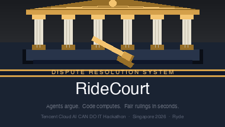
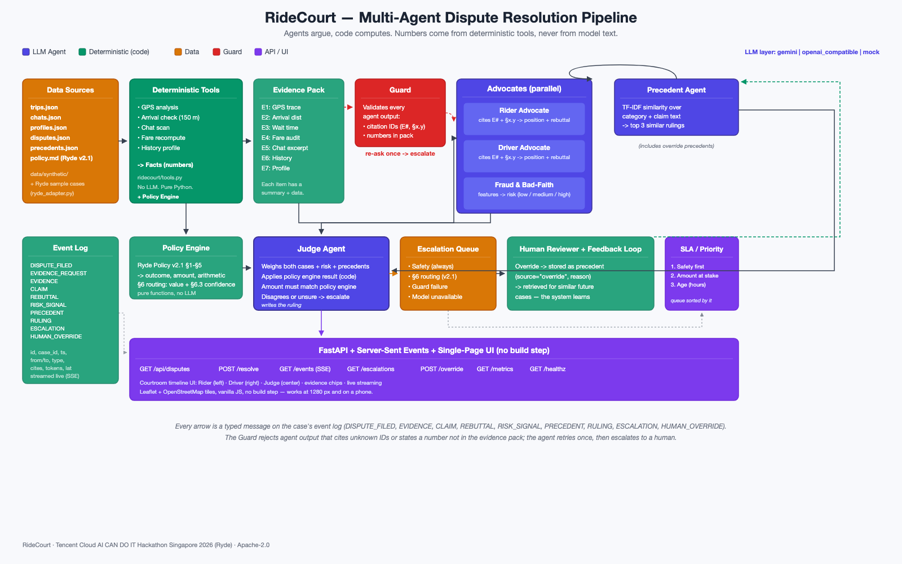

# RideCourt



Multi-agent autonomous dispute resolution for ride-hailing. Built for the
Tencent Cloud AI CAN DO IT Hackathon Singapore 2026 (Ryde challenge).

RideCourt resolves rider–driver disputes — route deviation, no-show,
fare and surge, property damage, and safety incidents — under **Ryde Dispute
Resolution Policy v2.1**: it gathers evidence, builds both sides of the case,
applies the policy, decides under §6 whether the AI may rule or a person must,
and issues a ruling with a plain-English explanation, in about half a minute
instead of 24–72 hours.

**Principle: agents argue, code computes.** Language models gather, argue,
and explain. Every number in a ruling (distances, minutes, dollars) and the
confidence that decides routing are computed by deterministic Python — never
typed by a model. Every claim an agent makes must cite evidence IDs (`E#`) and
v2.1 policy sections (`§1.3`), as v2.1 requires.

---

## The problem

Ride-hailing platforms take 24–72 hours to resolve disputes, with
inconsistent outcomes and no transparency for riders or drivers. Human
agents handle routine disputes one at a time, costing money and goodwill.
Safety incidents get queued alongside fare complaints instead of being
prioritised. Riders and drivers never see *why* a decision was made.

## Ryde Policy v2.1 and Ryde's sample cases

On 13 October Ryde shared its sample dataset with participants: the Ryde
Dispute Resolution Policy v2.1 and three cases with expected rulings. RideCourt
applies that policy, section by section, and runs Ryde's three cases in the
live app (listed first in the queue, marked "Ryde sample").

| Case | Ryde's expected ruling | RideCourt | Routing (§6) |
|:--|:--|:--|:--|
| DISP-001 route deviation | Partial refund of the excess distance fare, S$3.44 | Partial refund S$3.44 (§1.3: PIE vehicle fire justified the reroute, but the driver did not tell the rider) | Human sign-off: §6.2 sends route deviations over 2 km to a person; the S$3.44 recommendation is shown for one-click approval |
| DISP-002 no-show charge | Cancellation fee upheld | Fee upheld S$5.00 (§2.1 free wait expired 6 min after it began; §2.3 driver sent 4 messages and made 1 call) | AI final: the rider's fraud flag raises the bar to 95% (§6.3); confidence 96–100% |
| DISP-003 fare dispute | (not stated; §3.3 and precedent 7.2 give a full refund of the surge differential) | Refund S$4.50 = surgeable subtotal S$9.00 × (1.5 − 1.0), booking fee exempt (§3.4–3.5) | AI final: under S$10 (§6.1) |

- **Confidence is computed, not asked for.** §6.3 names four factors; RideCourt
  scores each from the case: evidence completeness (facts the section needs
  that the data actually has), policy clarity (margin between each measured
  value and its threshold; facts from system records score higher than facts
  inferred from chat text), precedent alignment (precedents with the same
  deciding facts and outcome agree, the same facts with another outcome
  conflict, different facts are distinguished), and party credibility (lowered
  only when the ruling favours, or rests on the word of, a party with a fraud
  flag or a contradicted statement). The ruling card shows each factor with
  the inputs it read.
- **Where v2.1 is ambiguous we say how we read it.** `data/policy.md` ends with
  the interpretations, for example: DISP-001's expected answer rules
  automatically although §6.2 sends deviations over 2 km to a person, so
  RideCourt computes the S$3.44 and asks for sign-off; the §1.3 "partial" and
  "full" refund rows both refund the excess distance fare; the free wait runs
  from the later of the scheduled pickup and the driver's arrival.
- **Ryde's answer keys never reach an agent.** The adapter
  (`ridecourt/ryde_adapter.py`) holds out `expected_ruling`,
  `recommended_ruling`, the dataset's own analyses and notes; a test builds
  every agent prompt for the three cases and fails if any of it appears.
  Another test checks that every number in every evidence item is a raw value
  from Ryde's file or a computation over raw values.
- Ryde's files are not redistributed in this repository. To run the three
  cases locally, put them in `data/ryde_samples/`; without them the app runs
  on the synthetic cases and the tests that need them are skipped.

## What it does

RideCourt automates the majority of standard dispute categories — route
deviation, no-show (rider or driver), fare and surge, property damage —
end-to-end:

1. **Gathers evidence** — deterministic tools analyse GPS traces, arrival
   distances, wait times, chat logs, fare breakdowns, and account history.
2. **Builds both sides** — a Rider Advocate and a Driver Advocate argue in
   parallel, each citing evidence and policy. A rebuttal round follows.
3. **Checks credibility** — a Fraud Agent computes deterministic risk
   signals (fraud flags, dispute and upheld rates, GPS contradictions) that
   feed §6.3 party credibility.
4. **Retrieves precedents** — the Precedent Agent finds the 3 most similar
   past rulings using TF-IDF keyword similarity.
5. **Applies policy** — the Policy Engine (pure Python functions, §1–§5 of
   v2.1) computes the outcome, refund amount, and a human-readable computation
   string.
6. **Routes under §6** — code computes the dispute value and the §6.3
   confidence, applies every §6.1 and §6.2 threshold and the fraud-flag rule,
   and takes the strictest: the AI's ruling is final, or a person signs off a
   recommended ruling.
7. **Issues a ruling** — the Judge weighs both cases, applies the policy
   engine result, considers risk and precedents, and writes the ruling with
   plain-English explanations to both parties and cited sections. Safety
   incidents always go to a human with a case file and no recommendation
   (§5.2).

Every inter-agent message is a typed event on a case log, streamed live to
the UI via Server-Sent Events — so the entire reasoning chain is visible.

## Architecture



**Pipeline:** Evidence Collection (deterministic tools) → Evidence Pack →
Rider/Driver Advocates + Fraud Agent + Precedent Agent (parallel) →
Policy Engine (code) → Guard (validation) → Judge → Ruling or Escalation →
Feedback Loop (human overrides become precedents).

**Key components:**

| Component | Role |
|:--|:--|
| **Data sources** | `data/synthetic/` (51 cases written for v2.1: trips, chats, profiles, disputes, labels, precedents) plus Ryde's sample cases through `ridecourt/ryde_adapter.py`. |
| **Deterministic tools** (`ridecourt/tools.py`) | Route and deviation-point analysis, traffic incidents on the recommended route, arrival and free-wait check, contact attempts (chat and call), surge log, photo evidence checks, history profile. No LLM calls. |
| **Evidence pack** | List of `E#` items, each with a summary, data, and source. Cited by every agent in every claim. |
| **Advocates** (`ridecourt/agents/advocate.py`) | Rider Advocate and Driver Advocate run in parallel, argue for their side, cite `E#` and `§x.y`, then rebut each other. |
| **Fraud agent** (`ridecourt/agents/fraud.py`) | Deterministic features first (fraud flags, dispute and upheld rates, GPS contradiction); the LLM only explains the signals. |
| **Precedent agent** (`ridecourt/agents/precedent.py`) | TF-IDF keyword similarity over category + claim text; top 3 past rulings; includes override precedents (learning loop). |
| **Judge** (`ridecourt/agents/judge.py`) | Weighs both cases + risk + precedents; applies the policy engine result; the amount must match; a Judge that disagrees or reports confidence below 0.7 sends the case to a person. |
| **Policy engine** (`ridecourt/policy.py`) | Pure functions for v2.1 §1–§5, and §6 routing with the computed §6.3 confidence. Returns outcome, amount, computation string, routing and its reason. |
| **Guard** (`ridecourt/guard.py`) | Validates every agent output: rejects unknown citation IDs or numbers not in the evidence pack. Re-asks once, then escalates. |
| **Escalation queue** (`ridecourt/escalation.py`) | Triggers: §6 routing, safety (§5), guard failure, model unavailable, Judge disagreement. Neutral case file. `GET /api/escalations`. |
| **Feedback loop** | Human override stored as a precedent (`source="override"`); retrieved for similar future cases; "learned from override" in timeline. |
| **API / SSE / UI** (`ridecourt/api.py`, `web/`) | FastAPI endpoints, Server-Sent Events for live streaming, single-page courtroom timeline UI. |

## How the agents work: agents argue, code computes

This is the core design decision and the answer to "fairness and
transparency" and "inconsistent rulings":

- **Language models gather, argue, and explain.** The Rider Advocate argues
  for the rider, the Driver Advocate argues for the driver, the Fraud Agent
  explains risk signals, the Precedent Agent explains similar rulings, and
  the Judge writes the ruling and plain-English messages to both parties.
- **Code computes every number.** Distances (haversine), arrival radius,
  wait times, fare recomputation, refund amounts — all computed by
  deterministic Python in `ridecourt/tools.py` and `ridecourt/policy.py`.
  The Judge's amount must equal the policy engine's amount; if the Judge
  disagrees it must escalate, not override.
- **Every claim cites evidence and policy.** Agent outputs must reference
  evidence IDs (`E3`) and v2.1 sections (`§1.3`). The Guard validates
  every output: unknown IDs or numbers not in the evidence pack trigger a
  re-ask, then escalation. This prevents hallucinated facts and numbers.
- **The event log is the audit trail.** Every inter-agent message is a typed
  event (`DISPUTE_FILED`, `EVIDENCE`, `CLAIM`, `REBUTTAL`, `RISK_SIGNAL`,
  `PRECEDENT`, `RULING`, `ESCALATION`, `HUMAN_OVERRIDE`) with timestamp,
  tokens, and latency — streamed live via SSE.

## How to run

### Prerequisites

- Python 3.12+ (the project uses pydantic v2, FastAPI, uvicorn, pytest)
- A virtualenv in `.venv/`

### Local (mock LLM, offline)

```bash
# Set up
python3.12 -m venv .venv && source .venv/bin/activate
pip install -r requirements.txt

# Run tests (offline, mock LLM)
LLM_PROVIDER=mock python -m pytest -q

# Start the API + UI
LLM_PROVIDER=mock uvicorn ridecourt.api:app --reload

# Open http://localhost:8000 — pick a dispute, click Resolve, watch the
# courtroom timeline stream live.

# Run the evaluation script
LLM_PROVIDER=mock python scripts/evaluate.py --provider mock
```

### With Gemini (Vertex AI)

```bash
# Authenticate
gcloud auth application-default login

# Set environment variables
export LLM_PROVIDER=gemini
export GOOGLE_GENAI_USE_VERTEXAI=true
export GOOGLE_CLOUD_PROJECT=your-project-id
export GOOGLE_CLOUD_LOCATION=global
export MODEL=gemini-3.8-flash

# Run
uvicorn ridecourt.api:app --reload
```

### Deploy to Google Cloud Run

```bash
export PROJECT_ID=your-project-id
# Optional: override the global daily resolve cap (default 300).
export DAILY_RESOLVE_CAP=300
./scripts/deploy.sh
```

The deploy script creates a dedicated service account with
`roles/aiplatform.user` and `roles/datastore.user`, creates a Firestore
database, deploys via `gcloud run deploy ridecourt --source .`, sets
`STATE_BACKEND=firestore` so case state survives instance restarts, runs one
instance (the live event stream is served by the instance that runs the case),
and waits for IAM propagation with a retry loop. `data/ryde_samples/` is
git-ignored but uploaded (see `.gcloudignore`).
See `Dockerfile` for the container image (python:3.12-slim, non-root user,
uvicorn on `$PORT`).

#### Cost guard for the public demo

To keep the live demo within budget, every `/api/disputes/{id}/resolve` call
is counted against a global daily cap (`DAILY_RESOLVE_CAP`, default **300**).
Once the cap is reached the API returns `429 Too Many Requests` with a clear
message saying the limit is exhausted and when it resets (UTC midnight). The
remaining budget is exposed in `GET /api/metrics` as
`daily_resolve_cap`, `resolves_today`, and `remaining_resolves_today`. The
per-IP limit (20/hour) still applies — the daily cap is the outer one.

See `.env.example` for all configuration options.

### Pre-resolve cases (warm the store)

`scripts/preresolve.py` resolves labelled cases in the current process
and writes results to the configured store. This is useful for populating
the store before a demo or for batch processing.

```bash
# Mock, offline (writes to the in-memory store — useful for testing)
LLM_PROVIDER=mock .venv/bin/python scripts/preresolve.py --provider mock

# Gemini (writes to Firestore when STATE_BACKEND=firestore)
LLM_PROVIDER=gemini \
GOOGLE_GENAI_USE_VERTEXAI=true \
GOOGLE_CLOUD_PROJECT=your-project \
GOOGLE_CLOUD_LOCATION=global \
MODEL=gemini-3.8-flash \
STATE_BACKEND=firestore \
.venv/bin/python scripts/preresolve.py --provider gemini
```

Options: `--limit N` (only first N cases), `--force` (re-resolve even if
already in the store), or pass specific dispute IDs as positional args.
The script prints one progress line per case to stderr and continues after
failures.

## Evaluation

The evaluation script (`scripts/evaluate.py`) runs every labelled synthetic
dispute through the full pipeline and reports:

- **Ruling accuracy** vs the policy label, per category (outcome and amount,
  amount within S$0.01)
- **Consistency** — the same case run 3 times gives the same outcome
- **Escalation rate** and whether every safety case escalated
- **Median and p90 time to ruling** and **tokens per case**

Results are written to `eval/results-<date>-<provider>.json`.

### Gemini 3.8 Flash results (13 October 2026)

Run with: `LLM_PROVIDER=gemini python scripts/evaluate.py --provider gemini --repeats 2`
(48 labelled cases, each run twice; full rows, including the guard problems of any escalated run, in `eval/results-2026-10-13-gemini.json`).

| Category | N | Outcome acc. | Amount acc. | Both acc. | Escalation rate | Errored runs | Consistency |
|:--|:--:|:--:|:--:|:--:|:--:|:--:|:--:|
| route_deviation | 16 | 100.0% | 100.0% | 100.0% | 0.0% | 0.0% | 100.0% |
| no_show_driver | 10 | 100.0% | 100.0% | 100.0% | 0.0% | 0.0% | 100.0% |
| no_show_rider | 10 | 100.0% | 100.0% | 100.0% | 0.0% | 0.0% | 100.0% |
| fare_error | 6 | 100.0% | 100.0% | 100.0% | 0.0% | 0.0% | 83.3% |
| safety | 6 | 100.0% | 100.0% | 100.0% | 100.0% | 0.0% | 100.0% |
| **Overall** | 48 | **100.0%** | **100.0%** | **100.0%** | **12.5%** | **0.0%** | **97.9%** |

- Every safety case escalated, as the policy requires, and no other case did in its first run.
- Both runs agreed on 47 of 48 cases. In one run of disp_fa_003, Vertex AI kept returning `429 RESOURCE_EXHAUSTED` through the retries, so the case went to a person as `model_unavailable`; its other run was correct. No run errored.
- Median time to ruling 26.5 s (p90 85.9 s); median 9,118 tokens per case. The times include waiting while Vertex AI was busy; when it was not, a case took 15 to 20 s.
- The machine running the evaluation restarted after 36 cases; the other 12 ran with `--resume` on the same code (the evaluation saves after every case).
- What this measures: the labels come from the same policy clauses the system applies, so the evaluation tests whether the multi-agent pipeline reaches the policy result without inventing numbers or escalating needlessly. It is not an independent human labelling. Reading every escalation of earlier runs found real defects, each fixed in the build log: the rider no-show clause read the minutes past the ETA instead of the minutes waited within 150 m (step 11); the Judge was told to cite the bad-faith clause P-BF-1 but the policy engine never applied it, so every high-risk claimant escalated (step 12); the Judge quoted a precedent's distance, which the guard accepted only from this case's evidence (step 15).
- An earlier full run on 11 October (before steps 11 to 16) gave 95.8% outcome accuracy; it is kept in `eval/results-2026-10-11-gemini.json`.

### Mock provider results

Run with: `LLM_PROVIDER=mock python scripts/evaluate.py --provider mock --repeats 2` (offline, a few seconds; it writes `eval/results-<date>-mock.json`).

| Category | N | Outcome acc. | Amount acc. | Both acc. | Escalation rate | Errored runs | Consistency |
|:--|:--:|:--:|:--:|:--:|:--:|:--:|:--:|
| route_deviation | 16 | 100.0% | 100.0% | 100.0% | 0.0% | 0.0% | 100.0% |
| no_show_driver | 10 | 100.0% | 100.0% | 100.0% | 0.0% | 0.0% | 100.0% |
| no_show_rider | 10 | 100.0% | 100.0% | 100.0% | 0.0% | 0.0% | 100.0% |
| fare_error | 6 | 100.0% | 100.0% | 100.0% | 0.0% | 0.0% | 100.0% |
| safety | 6 | 100.0% | 100.0% | 100.0% | 100.0% | 0.0% | 100.0% |
| **Overall** | 48 | **100.0%** | **100.0%** | **100.0%** | **12.5%** | **0.0%** | **100.0%** |

The mock provider only checks that the pipeline, the guard and the policy engine fit together; it states numbers only from the evidence items it cites (step 14b).

## How CodeBuddy was used to build it

The project was built spec-first on **CodeBuddy Code** in headless mode, with other tools assisting. Each build step is one prompt, run as its own CodeBuddy session. Between steps a reviewer ran the tests, real Gemini cases and the UI, and wrote what it found into the next prompt, which is why the later steps exist.

| Step | Task | Prompt |
|:--|:--|:--|
| 01 | Foundation: scaffold, data, policy | `prompts/01-foundation.md` |
| 02 | Evidence tools | `prompts/02-evidence-tools.md` |
| 03 | LLM layer + guard | `prompts/03-llm-and-guard.md` |
| 04 | Agents + orchestrator | `prompts/04-agents-orchestrator.md` |
| 04b | Real-run fixes | `prompts/04b-real-run-fixes.md` |
| 04c | Finish rebuttal | `prompts/04c-finish-rebuttal.md` |
| 05 | API + UI | `prompts/05-api-ui.md` |
| 06 | Evaluation | `prompts/06-evaluation.md` |
| 07 | Stretch agents | `prompts/07-stretch-agents.md` |
| 08 | Deploy + docs | `prompts/08-deploy-docs.md` |
| 09 | Polish from UI review | `prompts/09-polish.md` |
| 10 | Docs polish | `prompts/10-docs-polish.md` |
| 11 | Fixes from the real-Gemini evaluation | `prompts/11-eval-findings.md` |
| 12 | Fixes found while recording the demo (P-BF-1, SLA rank, negative extra, visitor IP) | `prompts/12-review-findings.md` |
| 13 | Retry transient model errors; evaluation saves after every case | `prompts/13-resilience.md` |
| 13b | Retry malformed model answers | `prompts/13b-validation-retry.md` |
| 14 | Show the Judge's reasoning and the bad-faith finding | `prompts/14-show-judge-reasoning.md` |
| 14b | Show learning from overrides; mock numbers only from evidence | `prompts/14b-learning-visible-and-mock.md` |
| 15 | Precedent numbers and the guard | `prompts/15-precedent-numbers.md` |
| 15b | Numbers in a claim a person types | `prompts/15b-claim-numbers.md` |
| 16 | Evidence panel layout; Firestore persistence | `prompts/16-layout-and-persistence.md` |
| 17 | Stored events for cases resolved by another process | `prompts/17-events-from-store.md` |
| 18 | Ryde Dispute Resolution Policy v2.1 and Ryde's sample cases | `prompts/18-ryde-policy-v2.1.md` |
| 18b | Evidence faithful to Ryde's data; precedents as v2.1 states them; dispute value; routing labels | `prompts/18b-v2.1-review-findings.md` |
| 18c | Evidence/source agreement test; §6.3 factors from margins and deciding facts | `prompts/18c-evidence-and-confidence.md` |

`docs/BUILD_LOG.md` lists every session with its duration, turns, result and test count (from 55 tests after step 1 to 337 after step 16), including the three times CodeBuddy credits ran out. The `CODEBUDDY.md` file enforces the project rules across all sessions: agents argue, code computes; Python 3.12, FastAPI and pydantic v2; tests must pass with `LLM_PROVIDER=mock`; English for all code and docs; commit after each task. The raw session transcripts are kept privately and were submitted with the entry as the CodeBuddy conversation history.

## Stretch goals

| Feature | Status | Description |
|:--|:--|:--|
| Fraud & Bad-Faith Agent | Done | Runs in parallel with advocates; deterministic features (fraud flags, dispute and upheld rates, GPS contradiction); feeds §6.3 party credibility; Judge mentions high-risk signals explicitly |
| Policy & Precedent Agent | Done | TF-IDF keyword similarity over category, facts and claim text; top 3 past rulings; Judge states consistency |
| Escalation Protocol | Done | v2.1 §6 routing (value thresholds, route deviation over 2 km, repair claims, fraud flags at 95%) with computed §6.3 confidence; safety (§5); guard failure; model unavailable; neutral case file; "Approve recommended ruling" for one-click sign-off; `GET /api/escalations` queue |
| Learning Feedback Loop | Done | Override stored as precedent (`source="override"`); retrieved for similar cases; "learned from override" in timeline |
| SLA & Routing | Done | Priority = safety first, then amount at stake and age; queue sorts by it |
| Cloud Run deployment | Done | `Dockerfile` + `scripts/deploy.sh`; dedicated SA with `roles/aiplatform.user` + `roles/datastore.user`; Firestore persistence via `STATE_BACKEND=firestore`; one instance, because the live event stream is served by the instance that runs the case |

## Limits

- 51 synthetic cases written for v2.1 (route deviation, no-show by rider
  and by driver, fare and surge, property damage, safety, one promo-code case
  that v2.1 does not cover) plus Ryde's three sample cases. The synthetic labels
  are written from each scenario's intent, not computed by the policy engine.
- Photos are judged from their metadata (in-app camera, timestamp, hours
  after the trip, link to the trip); the images themselves are not analysed.
- The mock provider is deterministic but limited — it does not produce
  real natural-language arguments; its purpose is offline testing.
- State is in-memory by default. Set `STATE_BACKEND=firestore` to persist
  case files, events, statuses, overrides, precedents, and the daily
  resolve counter to Firestore so they survive instance restarts and are
  visible across processes. The Cloud Run deploy script enables this
  automatically.
- Single rebuttal round. A production system might allow more rounds with
  a token budget.
- Gemini 3.8 Flash runs on Vertex AI's shared capacity. When it is busy, Vertex AI returns
  429 and RideCourt retries, so a ruling that normally takes 15 to 20 seconds can take a few
  minutes; if the model stays unavailable, the case goes to a person (`model_unavailable`).

## Licence

[Apache-2.0](LICENSE). Copyright 2026 RideCourt Contributors.
